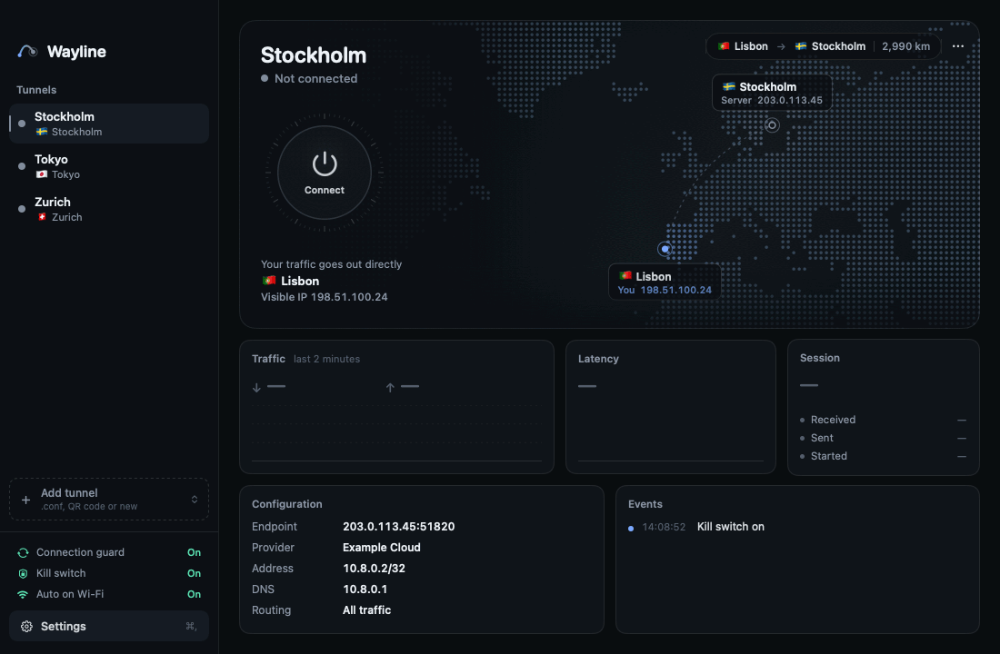
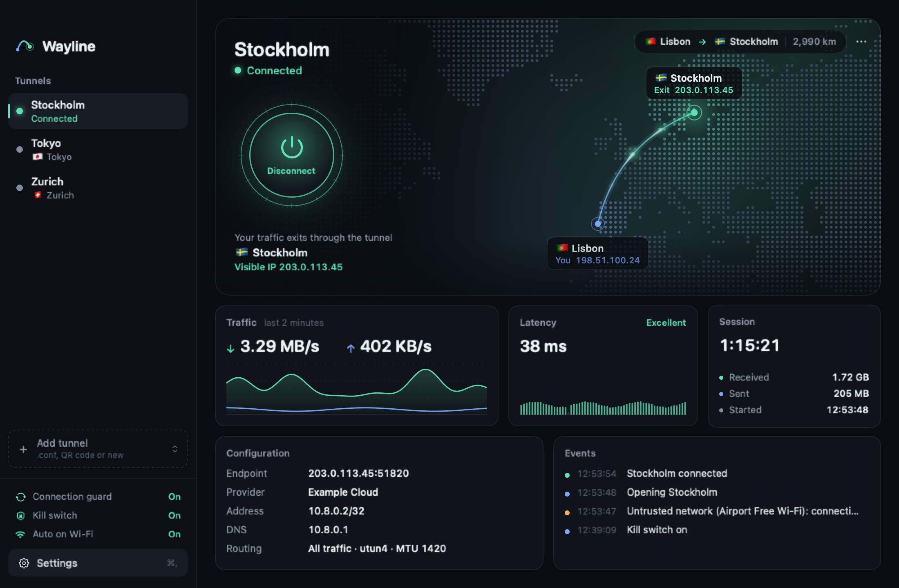
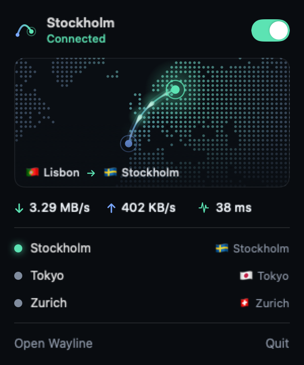
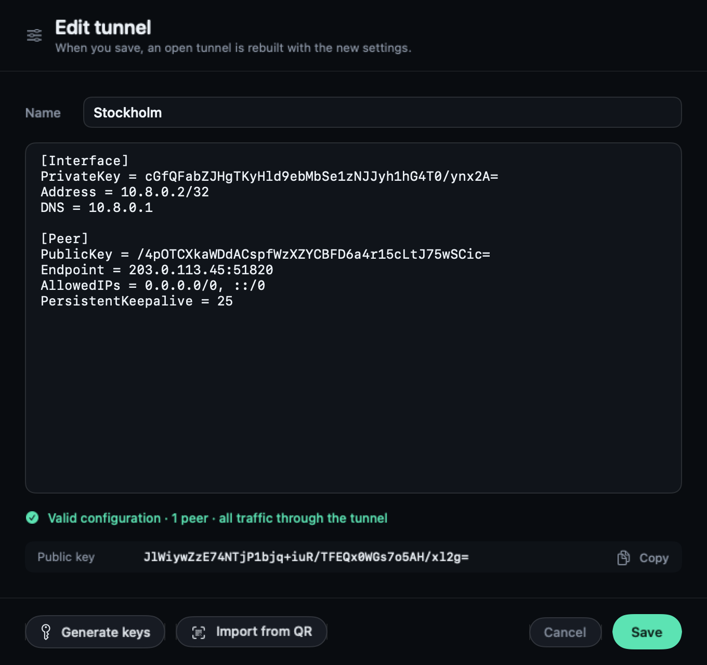
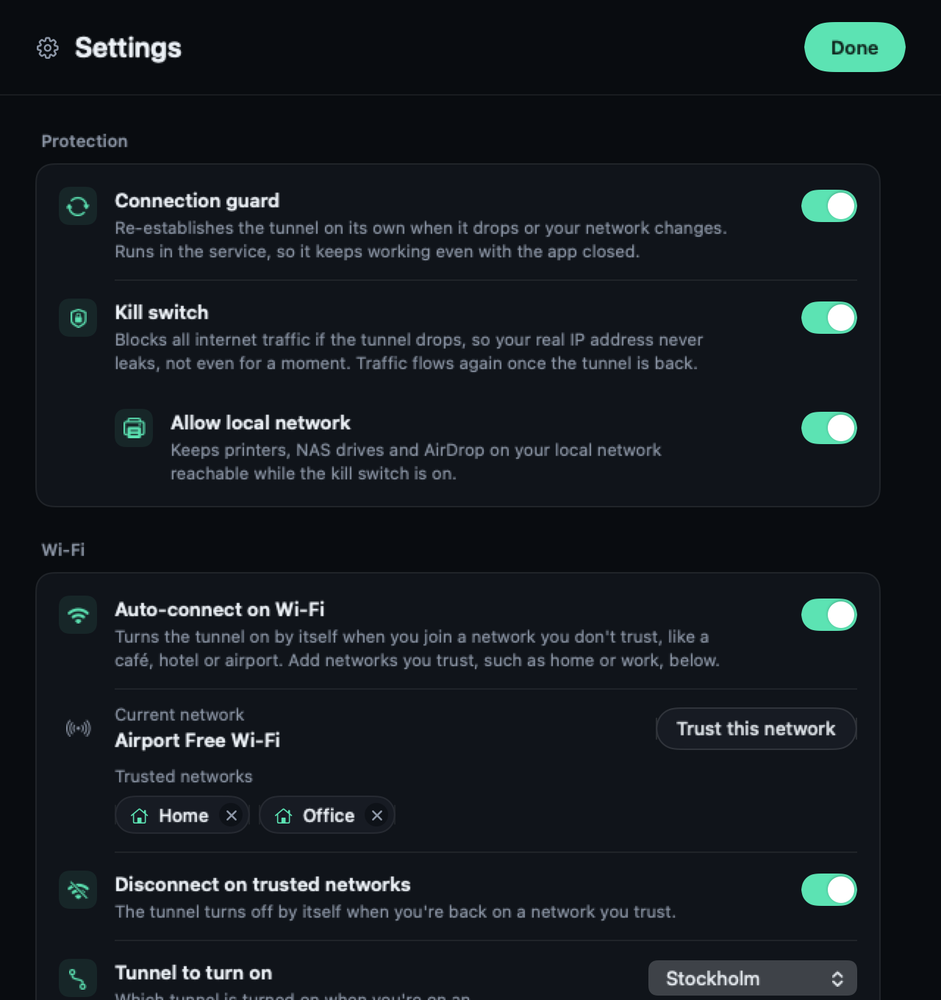

<div align="center">


# Wayline

**A WireGuard client for macOS with its own tunnel engine.**

[](#install)
[](#install)
[](https://github.com/emresteee/Wayline/releases/latest)
[](#build-from-source)
[](LICENSE)

[**Download for macOS**](https://github.com/emresteee/Wayline/releases/latest) · **English** · [Türkçe](README.tr.md)

<br>



</div>

<br>

Wayline connects your Mac to any WireGuard server. Your VPN provider or your own server gives you a `.conf` file, and Wayline turns it into a working tunnel with one click. It does not need the official WireGuard app, and the tunnel keeps running even when the app is closed.

When the tunnel is on, your traffic leaves through the server, so websites see the server's IP address instead of yours. Wayline shows you where your traffic goes, how fast it moves, and everything that happens to the connection.

## Highlights

<table>
  <tr>
    <td width="33%" valign="top">
      <h3>⚡ Fast</h3>
      The tunnel is up in about 70 ms, and the first handshake usually completes in under 100 ms.
    </td>
    <td width="33%" valign="top">
      <h3>🛡️ Kill switch</h3>
      If the tunnel drops, all traffic is blocked, so your real IP address never leaks.
    </td>
    <td width="33%" valign="top">
      <h3>🔁 Connection guard</h3>
      Renews a stale handshake, rebuilds a dead tunnel and follows you across networks.
    </td>
  </tr>
  <tr>
    <td valign="top">
      <h3>📶 Auto-connect</h3>
      Turns on by itself on café, hotel and airport Wi-Fi, and off again at home.
    </td>
    <td valign="top">
      <h3>🗺️ Live route map</h3>
      See the route from you to the server, with live traffic and latency.
    </td>
    <td valign="top">
      <h3>🧩 Own engine</h3>
      Built-in <code>wireguard-go</code> and a system service. The official WireGuard app is not needed.
    </td>
  </tr>
</table>

## Screenshots

<div align="center">
  
  <sub>Main window: route map, traffic, latency, session and event log</sub>
</div>

<br>

<table>
  <tr>
    <td width="32%" align="center" valign="top">
      <br>
      <sub>Menu bar panel: status and tunnels at a glance</sub>
    </td>
    <td width="68%" align="center" valign="top">
      <br>
      <sub>Editor: live validation, key generation and QR import</sub>
    </td>
  </tr>
</table>

<div align="center">
  <br>
  <sub>Settings: every option explains what it does</sub>
</div>

<br>

> All screenshots use example data. The locations, addresses and keys are not real.

## Features

### Connection
- **Own engine.** `wireguard-go` is built into the app, and a small system service manages the tunnel, routes and DNS.
- **Stays up without the app.** The tunnel keeps running when you close the window or quit, and comes back after a restart.
- **Connection guard.** If the server stops answering, Wayline renews the handshake without dropping the tunnel. If that does not help, it rebuilds the tunnel, waiting a little longer between attempts (5 s up to 120 s). It also moves the connection when you switch between Wi-Fi and Ethernet.

### Protection
- **Kill switch.** Blocks all internet traffic if the tunnel drops.
- **Allow local network.** Printers, NAS drives and AirDrop stay reachable while the kill switch is on.

### Wi-Fi
- **Auto-connect on untrusted networks**, using the tunnel you choose.
- **Trusted networks** such as home or work, where the tunnel can turn itself off.

macOS only shows Wi-Fi names to apps with location permission. Wayline asks for it only to read the network name, and never stores or sends your location.

### Tunnels
- **Import** a `.conf` file or an image of a WireGuard QR code: drag it onto the window or use **Add tunnel**.
- **Edit** with live validation, so mistakes show up while you type.
- **Create** a tunnel from scratch with a fresh key pair, then copy the public key for your server.
- **Export** any tunnel back to a `.conf` file.

### Everyday use
- **Menu bar panel** to check status and switch tunnels without opening the window.
- **Notifications** when the tunnel connects, drops or turns on automatically.
- **Global shortcut** ⌃⌥⌘W to connect or disconnect from any app.
- **Launch at login**, and **English or Turkish**, following your system language by default.

## Install

1. Download **Wayline.dmg** from [the latest release](https://github.com/emresteee/Wayline/releases/latest) and drag **Wayline** into **Applications**.
2. Wayline is not notarized by Apple yet. The first time, right-click Wayline in Applications and choose **Open**.
3. Wayline asks for your administrator password once to install its service. After that, no password is needed.

Requires macOS 14 Sonoma or later on Apple Silicon or Intel.

<details>
<summary><b>Uninstall</b></summary>

<br>

Open **Settings › Service › Uninstall…** in the app, or run:

```sh
sudo bash /Applications/Wayline.app/Contents/Resources/Service/uninstall.sh
```

Then move Wayline to the Trash. Your tunnels stay in `~/Library/Application Support/Wayline` until you delete that folder.

</details>

## Privacy and security

- Tunnel configurations, including private keys, stay on your Mac in `~/Library/Application Support/Wayline/Tunnels`, readable only by you.
- The service only accepts requests from root, the user who installed it, and administrators. The system verifies every connection.
- To draw the map, Wayline looks up the location of your public IP and the server's IP at `ipinfo.io`. Nothing else leaves your Mac. There is no analytics or telemetry.

## Build from source

Requires macOS 14+, the Command Line Tools (Xcode is not needed), Go (`brew install go`) and Python 3.

```sh
git clone https://github.com/emresteee/Wayline.git
cd Wayline
./scripts/build.sh
```

This creates `build/Wayline.app` and `build/Wayline.dmg` as a universal app. The script:

1. Builds `wireguard-go` from a pinned commit for Apple Silicon and Intel.
2. Builds the Swift targets for both architectures and merges them with `lipo`.
3. Draws the app icon and signs the bundle ad hoc.
4. Packages the DMG with `dmgbuild`, which it installs into `.build/dmgvenv`.

<details>
<summary><b>How it works</b></summary>

<br>

```
Wayline.app (you)  ── local socket ──▶  wayline-daemon (system service)
                                          ├─ wireguard-go   the WireGuard tunnel (utun)
                                          ├─ ifconfig/route addresses and routes
                                          ├─ configd        DNS while the tunnel is up
                                          └─ pf             kill switch rules
```

| Part | Folder | Role |
|---|---|---|
| `WaylineCore` | `Sources/WaylineCore` | Reads and writes `.conf` files, handles keys, defines the app ↔ service protocol |
| `Wayline` | `Sources/Wayline` | The SwiftUI app |
| `wayline-daemon` | `Sources/WaylineDaemon` | The system service: tunnel lifecycle, connection guard, routes, DNS, kill switch |

The service logs every connect and disconnect, with step timings, to `/Library/Logs/Wayline/daemon.log`.

</details>

<details>
<summary><b>Troubleshooting</b></summary>

<br>

| Problem | Check |
|---|---|
| The tunnel does not come up | `/Library/Logs/Wayline/daemon.log` |
| Websites do not load | DNS with `scutil --dns`, routes with `netstat -rn -f inet` |
| No internet after quitting | The kill switch may still be on. Turn it off in Settings, or run `sudo pfctl -a com.apple/250.Wayline -F rules` |

</details>

## License

[MIT](LICENSE). Wayline includes [wireguard-go](https://git.zx2c4.com/wireguard-go), which is also MIT licensed. WireGuard is a registered trademark of Jason A. Donenfeld. Wayline is not affiliated with the WireGuard project.
