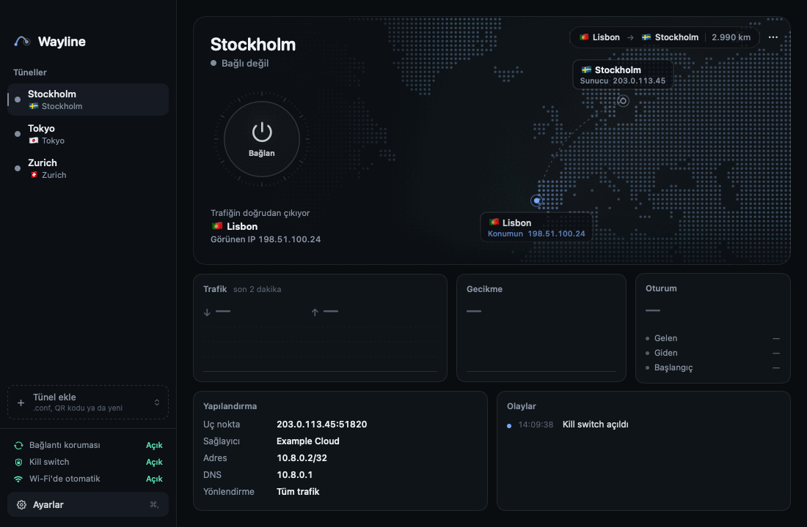
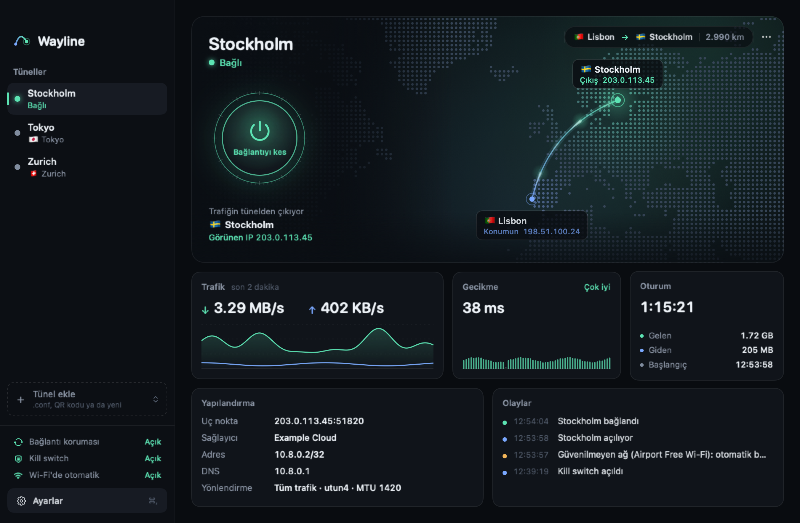
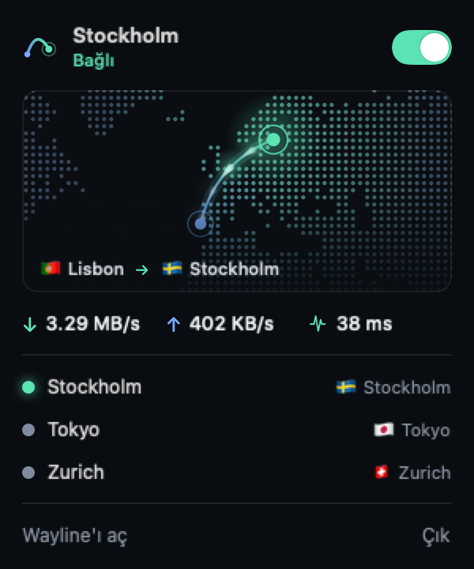
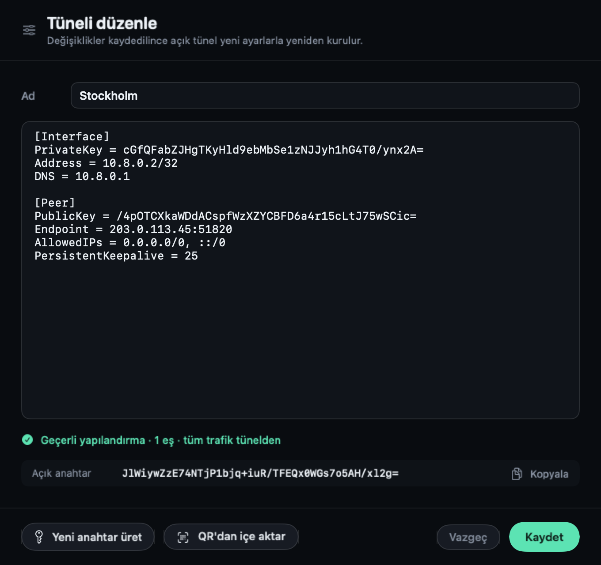
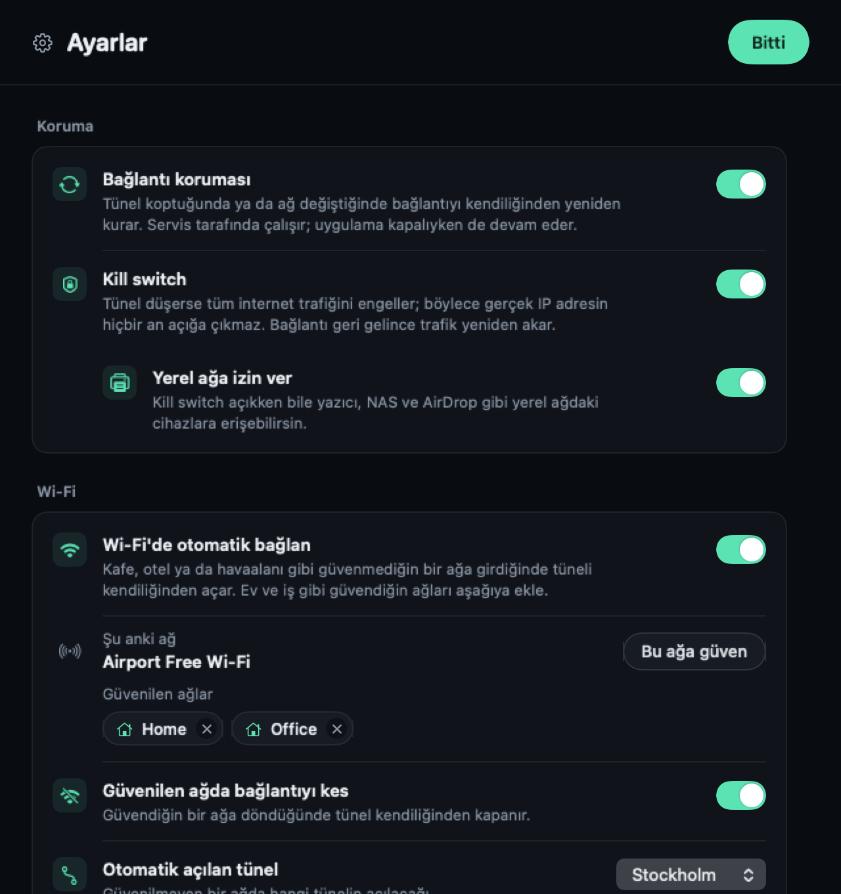

<div align="center">


# Wayline

**Kendi tünel motoruyla çalışan macOS WireGuard istemcisi.**

[](#kurulum)
[](#kurulum)
[](https://github.com/emresteee/Wayline/releases/latest)
[](#kaynaktan-derleme)
[](LICENSE)

[**macOS için indir**](https://github.com/emresteee/Wayline/releases/latest) · [English](README.md) · **Türkçe**

<br>



</div>

<br>

Wayline, Mac'ini herhangi bir WireGuard sunucusuna bağlar. VPN sağlayıcın ya da kendi sunucun sana bir `.conf` dosyası verir; Wayline bunu tek tıkla çalışan bir tünele dönüştürür. Resmi WireGuard uygulamasına ihtiyaç duymaz ve uygulama kapalıyken de tünel açık kalır.

Tünel açıkken trafiğin sunucu üzerinden çıkar; siteler senin IP adresini değil, sunucunun IP adresini görür. Wayline trafiğinin nereden çıktığını, ne hızda aktığını ve bağlantıda olan her şeyi gösterir.

## Öne çıkanlar

<table>
  <tr>
    <td width="33%" valign="top">
      <h3>⚡ Hızlı</h3>
      Tünel yaklaşık 70 ms'de kurulur, ilk el sıkışma genelde 100 ms'nin altında tamamlanır.
    </td>
    <td width="33%" valign="top">
      <h3>🛡️ Kill switch</h3>
      Tünel düşerse tüm trafik engellenir; gerçek IP adresin hiçbir an açığa çıkmaz.
    </td>
    <td width="33%" valign="top">
      <h3>🔁 Bağlantı koruması</h3>
      Bayatlayan el sıkışmayı yeniler, düşen tüneli yeniden kurar, ağ değişince seni takip eder.
    </td>
  </tr>
  <tr>
    <td valign="top">
      <h3>📶 Otomatik bağlanma</h3>
      Kafe, otel ve havaalanı Wi-Fi'sinde kendiliğinden açılır, evde yeniden kapanır.
    </td>
    <td valign="top">
      <h3>🗺️ Canlı rota haritası</h3>
      Senden sunucuya uzanan rotayı canlı trafik ve gecikmeyle birlikte gör.
    </td>
    <td valign="top">
      <h3>🧩 Kendi motoru</h3>
      Dahili <code>wireguard-go</code> ve bir sistem servisi; resmi WireGuard uygulaması gerekmez.
    </td>
  </tr>
</table>

## Ekran görüntüleri

<div align="center">
  
  <sub>Ana pencere: rota haritası, trafik, gecikme, oturum ve olay günlüğü</sub>
</div>

<br>

<table>
  <tr>
    <td width="32%" align="center" valign="top">
      <br>
      <sub>Menü çubuğu paneli: durum ve tüneller tek bakışta</sub>
    </td>
    <td width="68%" align="center" valign="top">
      <br>
      <sub>Editör: canlı doğrulama, anahtar üretme ve QR'dan içe aktarma</sub>
    </td>
  </tr>
</table>

<div align="center">
  <br>
  <sub>Ayarlar: her seçeneğin altında ne işe yaradığı yazar</sub>
</div>

<br>

> Tüm ekran görüntülerinde örnek veriler kullanılmıştır. Konumlar, adresler ve anahtarlar gerçek değildir.

## Özellikler

### Bağlantı
- **Kendi motoru:** `wireguard-go` uygulamanın içinde gelir; tüneli, rotaları ve DNS'i küçük bir sistem servisi yönetir.
- **Uygulama olmadan da açık kalır:** pencereyi kapatsan ya da çıksan da tünel çalışmaya devam eder; Mac yeniden başlayınca geri gelir.
- **Bağlantı koruması:** sunucu yanıt vermeyi keserse Wayline tüneli kapatmadan el sıkışmayı yeniler. Bu yetmezse tüneli baştan kurar ve denemeler arasında biraz daha uzun bekler (5 sn'den 120 sn'ye). Wi-Fi ile Ethernet arasında geçiş yaptığında bağlantıyı yeni ağa taşır.

### Koruma
- **Kill switch:** tünel düşerse tüm internet trafiğini engeller.
- **Yerel ağa izin ver:** kill switch açıkken bile yazıcı, NAS ve AirDrop erişilebilir kalır.

### Wi-Fi
- **Güvenilmeyen ağlarda otomatik bağlanma**, seçtiğin tünelle.
- **Güvenilen ağlar:** ev ya da iş gibi ağlarda tünel kendiliğinden kapanabilir.

macOS Wi-Fi adını yalnızca konum izni olan uygulamalara gösterir. Wayline bu izni yalnızca ağ adını okumak için ister; konumunu saklamaz ve hiçbir yere göndermez.

### Tüneller
- **İçe aktar:** bir `.conf` dosyasını ya da WireGuard QR kodu içeren bir görseli pencereye sürükle ya da **Tünel ekle**'yi kullan.
- **Düzenle:** canlı doğrulamayla; hatalar yazarken görünür.
- **Oluştur:** sıfırdan, yeni bir anahtar çiftiyle; ardından açık anahtarı sunucun için kopyala.
- **Dışa aktar:** herhangi bir tüneli yeniden `.conf` dosyası olarak kaydet.

### Günlük kullanım
- **Menü çubuğu paneli:** pencereyi açmadan durumu gör ve tünel değiştir.
- **Bildirimler:** tünel bağlandığında, koptuğunda ya da kendiliğinden açıldığında.
- **Genel kısayol:** her uygulamadayken ⌃⌥⌘W ile bağlan ya da bağlantıyı kes.
- **Girişte başlatma**, ayrıca **Türkçe ya da İngilizce** arayüz (varsayılan olarak sistem dilini izler).

## Kurulum

1. [Son sürümden](https://github.com/emresteee/Wayline/releases/latest) **Wayline.dmg**'yi indir ve **Wayline**'ı **Applications** klasörüne sürükle.
2. Wayline henüz Apple tarafından onaylanmadı (notarize edilmedi). İlk açılışta Applications'ta Wayline'a sağ tıklayıp **Aç**'ı seç.
3. Wayline servisini kurmak için bir kez yönetici şifreni ister; sonrasında şifre gerekmez.

macOS 14 Sonoma ya da daha yenisi gerekir; Apple Silicon ve Intel desteklenir.

<details>
<summary><b>Kaldırma</b></summary>

<br>

Uygulamada **Ayarlar › Servis › Servisi kaldır…**'ı seç ya da şunu çalıştır:

```sh
sudo bash /Applications/Wayline.app/Contents/Resources/Service/uninstall.sh
```

Ardından Wayline'ı Çöp Sepeti'ne taşı. Tünellerin, `~/Library/Application Support/Wayline` klasörünü silene kadar Mac'inde kalır.

</details>

## Gizlilik ve güvenlik

- Özel anahtarlar dahil tünel yapılandırmaları Mac'inde, `~/Library/Application Support/Wayline/Tunnels` içinde yalnızca senin okuyabileceğin şekilde durur.
- Servis yalnızca root'tan, servisi kuran kullanıcıdan ve yöneticilerden gelen istekleri kabul eder; her bağlantıyı sistem doğrular.
- Haritayı çizmek için Wayline, genel IP adresinin ve sunucunun IP adresinin konumunu `ipinfo.io`'dan sorgular. Bunun dışında Mac'inden hiçbir şey çıkmaz; analiz ya da telemetri yoktur.

## Kaynaktan derleme

macOS 14+, Command Line Tools (Xcode gerekmez), Go (`brew install go`) ve Python 3 gerekir.

```sh
git clone https://github.com/emresteee/Wayline.git
cd Wayline
./scripts/build.sh
```

Bu, universal bir uygulama olarak `build/Wayline.app` ve `build/Wayline.dmg` üretir. Betik sırasıyla:

1. `wireguard-go`'yu sabit bir commit'ten Apple Silicon ve Intel için derler.
2. Swift hedeflerini iki mimari için derleyip `lipo` ile birleştirir.
3. Uygulama simgesini çizer ve paketi ad-hoc imzalar.
4. DMG'yi `dmgbuild` ile paketler; `dmgbuild`'i `.build/dmgvenv` içine kendisi kurar.

<details>
<summary><b>Nasıl çalışır</b></summary>

<br>

```
Wayline.app (sen)  ── yerel soket ──▶  wayline-daemon (sistem servisi)
                                         ├─ wireguard-go   WireGuard tüneli (utun)
                                         ├─ ifconfig/route adresler ve rotalar
                                         ├─ configd        tünel açıkken DNS
                                         └─ pf             kill switch kuralları
```

| Parça | Klasör | Görevi |
|---|---|---|
| `WaylineCore` | `Sources/WaylineCore` | `.conf` dosyalarını okur ve yazar, anahtarları işler, uygulama ↔ servis protokolünü tanımlar |
| `Wayline` | `Sources/Wayline` | SwiftUI uygulaması |
| `wayline-daemon` | `Sources/WaylineDaemon` | Sistem servisi: tünelin yaşam döngüsü, bağlantı koruması, rotalar, DNS, kill switch |

Servis her bağlanma ve kesmeyi adım süreleriyle birlikte `/Library/Logs/Wayline/daemon.log` dosyasına yazar.

</details>

<details>
<summary><b>Sorun giderme</b></summary>

<br>

| Sorun | Bakılacak yer |
|---|---|
| Tünel açılmıyor | `/Library/Logs/Wayline/daemon.log` |
| Siteler açılmıyor | DNS için `scutil --dns`, rotalar için `netstat -rn -f inet` |
| Çıktıktan sonra internet yok | Kill switch hâlâ açık olabilir. Ayarlar'dan kapat ya da `sudo pfctl -a com.apple/250.Wayline -F rules` çalıştır |

</details>

## Lisans

[MIT](LICENSE). Wayline, yine MIT lisanslı olan [wireguard-go](https://git.zx2c4.com/wireguard-go)'yu içerir. WireGuard, Jason A. Donenfeld'in tescilli markasıdır; Wayline WireGuard projesiyle bağlantılı değildir.
